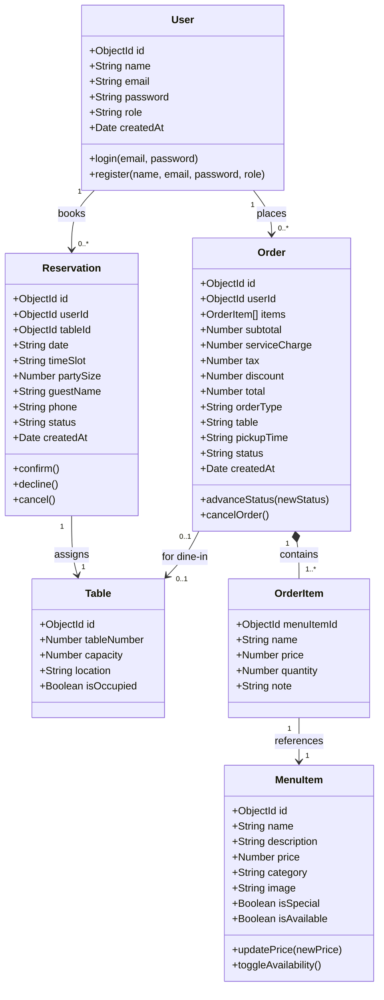

# UML Diagram 2: Class Diagram
**System:** DASTAAN Domain Entities & Relationships

---

### Relationship Multiplicities:
- A `User` can place 0 to many `Orders`.
- An `Order` compositionally owns 1 to many `OrderItems`.
- Each `OrderItem` references a distinct `MenuItem`.
- A `Reservation` maps exactly one `User` to one `Table` for a specific date and time slot.
