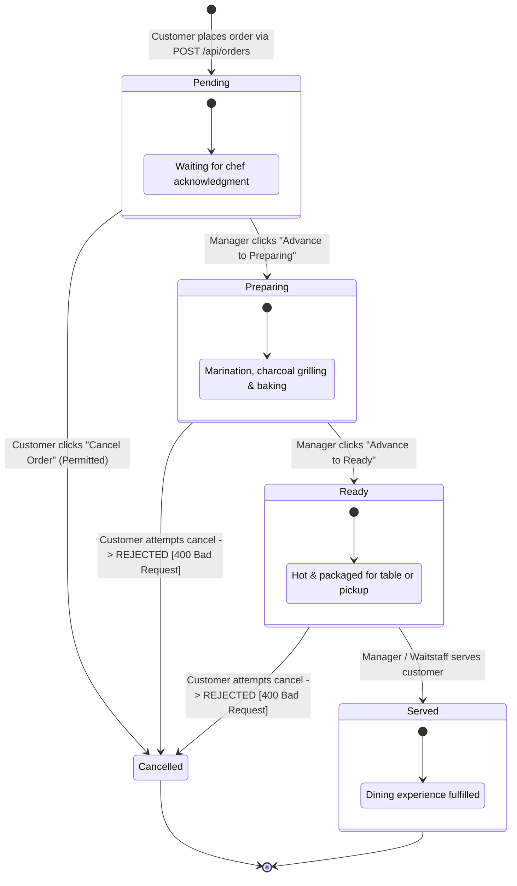

# UML Diagram 4: State Machine Diagram
**Subject:** Order Lifecycle & Status Transitions

---

### Transition Invariants & Guard Conditions:
1. **Forward-only Rule:** `Pending` ➔ `Preparing` ➔ `Ready` ➔ `Served`. Any backward transition (e.g. `Ready` ➔ `Preparing`) is strictly rejected with HTTP status **400 Bad Request**.
2. **Cancellation Guard:** `order.status === 'Pending'`. Once the kitchen moves the order into `Preparing`, cancellation requests are firmly blocked with **400 Bad Request**.
