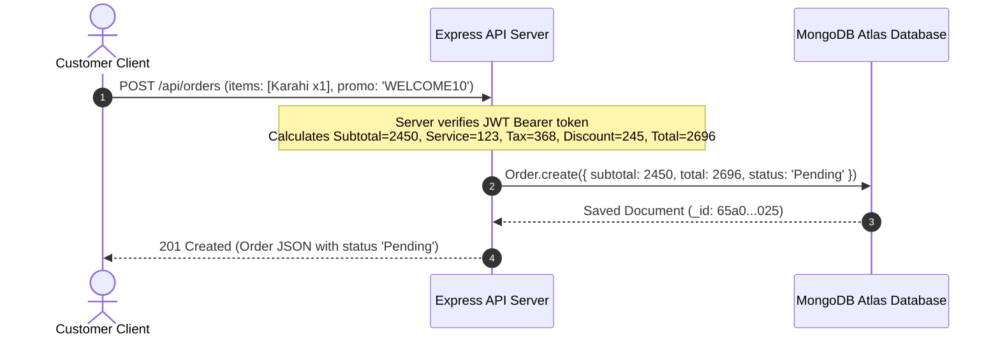
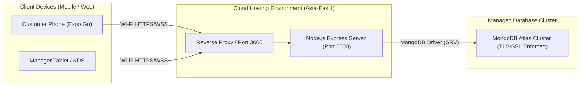

# Software Requirements Specification (SRS) — v2.0
**Project Title:** DASTAAN Restaurant Application (Backend & Distributed Integration)  
**Document Code:** A2-SRS-v2.0  
**Author:** Muhammad Anas (muhammadanus1239@gmail.com)  
**Status:** Approved  

---

## 1. Backend Scope & Architectural Evolution

While SRS v1.0 focused on client-side interactions and volatile state, **SRS v2.0** formalizes the server-authoritative backend infrastructure built using **Node.js, Express, and MongoDB Atlas**. 

The backend guarantees:
1. **Zero Data Loss:** Complete persistence across user sessions, devices, and network disconnections.
2. **Server-Authoritative Pricing:** All financial calculations (subtotals, 5% service, 15% sales tax, and voucher discounts) are strictly performed on the backend, making client-side tampering impossible.
3. **Transactional Conflict Prevention:** Prevents double-booking table reservations via unique composite checks (**409 Conflict**).
4. **Role-Based Operational Security:** Protects sensitive managerial operations (status advance, menu modifications) using cryptographic JWT verification.

---

## 2. Six New Backend Engineering Terms (Defined & Justified)

1. **ODM (Object Data Modeling):**  
   *Definition:* A software library (Mongoose) that manages relationships between data in memory and documents in MongoDB.  
   *Application in DASTAAN:* Provides schema validation, type casting, query building, and business logic enforcement for `User`, `MenuItem`, `Table`, `Reservation`, and `Order`.

2. **JWT (JSON Web Token):**  
   *Definition:* A compact, URL-safe means of representing claims securely between two parties.  
   *Application in DASTAAN:* Carries signed identity payloads (`id`, `name`, `email`, `role`) with an expiration period of 24 hours, eliminating server-side session lookup overhead.

3. **RBAC (Role-Based Access Control):**  
   *Definition:* An approach to restricting system access to authorized users based on their assigned organizational roles.  
   *Application in DASTAAN:* Enforced via `managerOnly` middleware; routes such as `POST /api/menu`, `PATCH /api/orders/:id/status`, and `PATCH /api/reservations/:id/status` return **403 Forbidden** if requested by patrons.

4. **REST (Representational State Transfer):**  
   *Definition:* An architectural style for distributed hypermedia systems utilizing standard HTTP verbs (`GET`, `POST`, `PUT`, `PATCH`, `DELETE`).  
   *Application in DASTAAN:* Consistent URI structuring (`/api/menu`, `/api/orders`, `/api/reservations`) with standard HTTP status codes (`200 OK`, `201 Created`, `400 Bad Request`, `401 Unauthorized`, `403 Forbidden`, `404 Not Found`, `409 Conflict`).

5. **Statelessness:**  
   *Definition:* The server treats each client request as an independent transaction, retaining no session state in server memory between requests.  
   *Application in DASTAAN:* The server extracts all authentication context from the `Authorization: Bearer <token>` header, allowing horizontal scaling across multiple instances.

6. **Connection Pooling:**  
   *Definition:* A cache of persistent database connections maintained by the ODM to handle concurrent queries efficiently without opening a new TCP socket per request.  
   *Application in DASTAAN:* Configured via Mongoose connection manager with a 5000ms server selection timeout, ensuring high throughput under heavy dinner peak loads.

---

## 3. Database Schema Design (5 Collections)

### 3.1 `users` Collection
```javascript
{
  _id: ObjectId,
  name: String (required),
  email: String (required, unique, lowercase),
  password: String (required, bcrypt hash),
  role: String (enum: ['customer', 'manager'], default: 'customer'),
  createdAt: Date,
  updatedAt: Date
}
```

### 3.2 `menuitems` Collection
```javascript
{
  _id: ObjectId,
  name: String (required, trim),
  description: String (required),
  price: Number (required, min: 0),
  category: String (enum: ['Starters', 'Mains', 'Desserts', 'Drinks']),
  image: String (required, URL),
  isSpecial: Boolean (default: false),
  isAvailable: Boolean (default: true)
}
```

### 3.3 `tables` Collection
```javascript
{
  _id: ObjectId,
  tableNumber: Number (required, unique, min: 1),
  capacity: Number (required, min: 1, max: 12),
  location: String (e.g. 'Garden View', 'Central Hall'),
  isOccupied: Boolean (default: false)
}
```

### 3.4 `reservations` Collection
```javascript
{
  _id: ObjectId,
  user: ObjectId (ref: 'User', required),
  table: ObjectId (ref: 'Table', required),
  date: String (required, format: 'YYYY-MM-DD'),
  timeSlot: String (required, e.g. '19:00'),
  partySize: Number (required, min: 1, max: 12),
  phone: String (required, match: /^03\d{2}-\d{7}$/),
  status: String (enum: ['Pending', 'Confirmed', 'Declined', 'Cancelled'], default: 'Pending'),
  createdAt: Date,
  updatedAt: Date
}
// Composite Index: { table: 1, date: 1, timeSlot: 1 } (Prevents double booking)
```

### 3.5 `orders` Collection
```javascript
{
  _id: ObjectId,
  user: ObjectId (ref: 'User', required),
  customerName: String,
  items: [
    {
      menuItem: ObjectId (ref: 'MenuItem'),
      name: String,
      price: Number,
      quantity: Number,
      note: String
    }
  ],
  subtotal: Number (calculated),
  serviceCharge: Number (5%),
  tax: Number (15%),
  discount: Number (voucher based),
  total: Number (final bill),
  orderType: String (enum: ['Dine-in', 'Takeaway']),
  table: String (e.g. 'Table 3'),
  pickupTime: String,
  promoCode: String,
  status: String (enum: ['Pending', 'Preparing', 'Ready', 'Served', 'Cancelled'], default: 'Pending'),
  createdAt: Date,
  updatedAt: Date
}
```

---

## 4. REST Endpoints Specification (15+ Endpoints)

| # | HTTP Method | Endpoint URI | Access Tier | Description & Status Return |
|---|---|---|---|---|
| 1 | `GET` | `/api/health` | Public | System uptime & healthcheck (200) |
| 2 | `POST` | `/api/auth/register` | Public | User registration with bcrypt hashing (201 / 400 / 409) |
| 3 | `POST` | `/api/auth/login` | Public | Credential validation & 1-day JWT generation (200 / 401) |
| 4 | `GET` | `/api/auth/me` | Protected | Authenticated user profile retrieval (200 / 401) |
| 5 | `GET` | `/api/menu` | Public | Filtered catalog with `?category=&search=` (200) |
| 6 | `GET` | `/api/menu/:id` | Public | Single dish detail with 400 format check (200 / 400 / 404) |
| 7 | `POST` | `/api/menu` | Manager | Create new culinary dish (201 / 400 / 403) |
| 8 | `PUT` | `/api/menu/:id` | Manager | Modify price or toggle availability (200 / 400 / 403 / 404) |
| 9 | `DELETE` | `/api/menu/:id` | Manager | Remove dish from catalog (200 / 403 / 404) |
| 10 | `POST` | `/api/orders` | Protected | Place order with server calculations (201 / 400 / 401) |
| 11 | `GET` | `/api/orders` | Protected | Customer sees own; Manager sees all queue (200 / 401) |
| 12 | `GET` | `/api/orders/:id` | Protected | Order receipt & progress retrieval (200 / 401 / 404) |
| 13 | `PATCH` | `/api/orders/:id/status` | Manager | Forward-only status advance (200 / 400 / 403) |
| 14 | `PATCH` | `/api/orders/:id/cancel` | Customer | Cancel order strictly during Pending (200 / 400 / 401) |
| 15 | `POST` | `/api/reservations` | Protected | Book table with 409 conflict detection (201 / 400 / 409) |
| 16 | `GET` | `/api/reservations` | Protected | View user bookings or restaurant calendar (200 / 401) |
| 17 | `PATCH` | `/api/reservations/:id/status` | Manager | Accept (`Confirmed`) or Decline booking (200 / 403) |
| 18 | `DELETE` | `/api/reservations/:id` | Customer | Cancel patron reservation (200 / 401 / 404) |

---

## 5. 3-Lifeline Sequence Diagram (Customer ➔ Server ➔ Database)



---

## 6. Deployment Architecture Diagram


